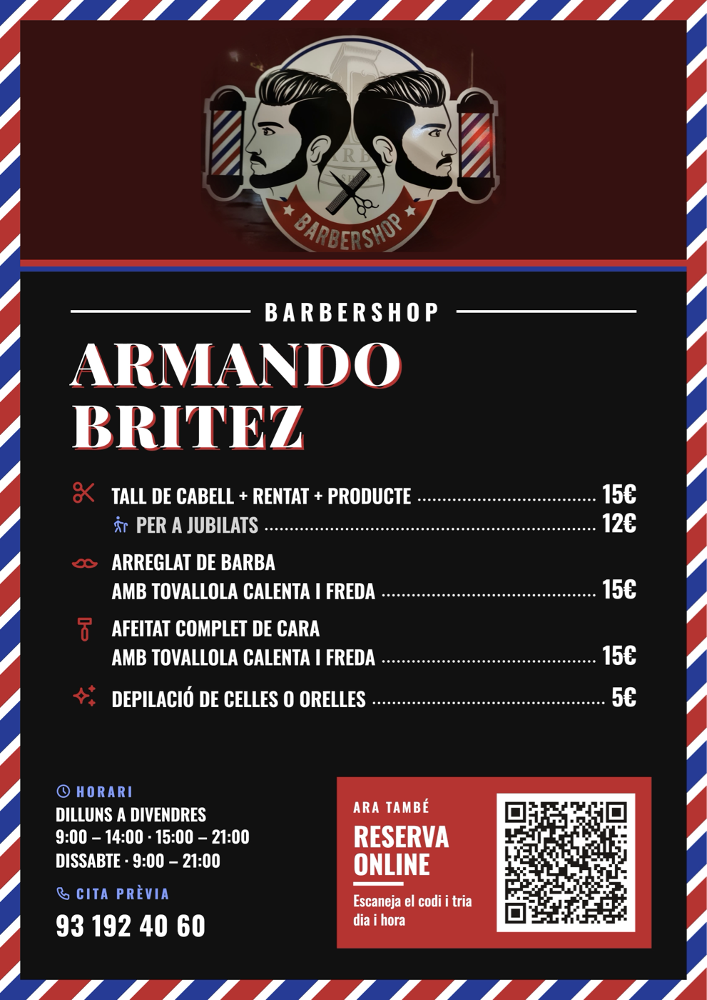
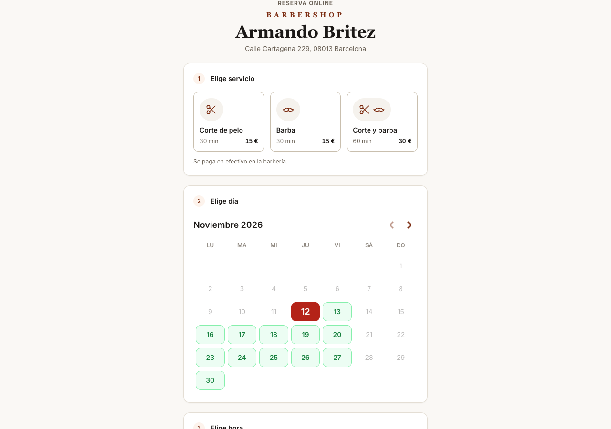
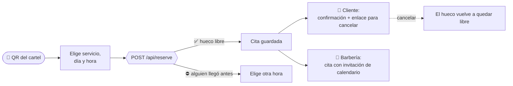

<div align="center">

# ✂️ Barbershop Booking

**Reservas online para la barbería del barrio. Sin apps de pago, sin comisiones y sin cuentas que crear.**

Escaneas el QR del cartel, eliges servicio, día y hora, y listo.


</div>

---

## 💈 La idea

Armando tiene una barbería en Barcelona. Sus clientes le reservaban por teléfono, a menudo con las tijeras
en la mano. Las apps de reservas cobran cada mes o se quedan una comisión por cita, y para un negocio pequeño
no salen a cuenta.

Así que se la hice yo, **por amor al arte**. Es una web sencilla con un QR en el cartel de la tienda: el
cliente lo escanea, reserva en un minuto y recibe un correo con un enlace para cancelar. La barbería recibe
cada cita en su correo con la invitación de calendario adjunta. No hay que instalar nada ni registrarse, y
los servicios que usa están todos en planes gratuitos.

<table>
<tr>
<td width="44%" align="center">

<br><sub><b>El cartel de la tienda.</b> El QR de abajo a la derecha lleva directo a la reserva.</sub>
</td>
<td width="56%" align="center">

<br><sub><b>La reserva.</b> Servicio → día → hora → tus datos.</sub>
</td>
</tr>
</table>

---

## 🧭 Cómo funciona



| Para el cliente | Para la barbería |
|---|---|
| Ve en tiempo real qué huecos quedan libres | Cada cita llega al correo con la invitación de calendario |
| Sin cuenta ni contraseña: nombre, apellidos y email | Si el cliente cancela, llega también la anulación |
| Cancela desde el enlace del correo | No paga nada: Vercel, Supabase y Resend en plan gratuito |
| El formulario caduca solo si se deja abierto y pasa la hora | Nombre, horario, servicios, precios y colores se cambian por variables de entorno |

---

## 🛡️ Lo que no puede salir mal

- **Nunca dos citas en el mismo hueco.** Diez reservas a la vez al mismo hueco dejan exactamente una. Lo
  garantiza un índice único parcial en Postgres, no la lógica de la aplicación, así que aguanta cualquier
  carrera de peticiones.
- **Reservar dos veces no duplica nada.** Si el mismo email repite la misma reserva, recibe la cita que ya
  tenía.
- **Un correo que falla no se lleva la cita.** La reserva se guarda igualmente y la pantalla de confirmación
  avisa.
- **Configuración que se valida sola.** Si una variable de entorno está mal, el despliegue falla con un
  mensaje que dice exactamente qué corregir, en vez de publicar algo roto.

---

## 🧱 Por dentro

```
src/
├── app/          páginas y Route Handlers de Next.js (book, cancel, api)
├── modules/
│   └── booking/  el dominio: casos de uso, puertos y adaptadores
└── shared/       configuración validada con zod, HTTP, infraestructura y UI
```

Arquitectura en **cuatro capas**, con puertos, inyección por constructor, un único *composition root* y DTOs.
La regla está escrita en [`.claude/rules/architecture.md`](.claude/rules/architecture.md) y es normativa: un
cambio que no encaja ahí se corrige, o se discute y se cambia la regla, pero nunca se hace una excepción en
silencio.

| Capa | Tecnología |
|---|---|
| Web | Next.js 15 (App Router, Server Components, Route Handlers) · CSS Modules con tokens |
| Datos | Supabase (Postgres 15) · migraciones en `supabase/` |
| Validación | zod en la entrada de la API y en la configuración |
| Correo | Resend (iCalendar adjunto para la barbería) |
| Hosting | Vercel Hobby |

**Una barbería, un despliegue.** Cada peluquería tiene su propio proyecto de Vercel, su base de datos y sus
variables. Así nadie comparte datos con nadie y no hace falta un panel de administración
([decisión 0001](docs/decisiones/0001-un-despliegue-por-peluqueria.md)).

---

## 🚀 Ponerlo en marcha

```bash
npm install
cp .env.example .env.local     # rellénalo: guía en docs/PERSONALIZAR.md
npm run db:start               # Postgres local
npm run dev:local              # http://localhost:3000
```

| Quiero… | Lee |
|---|---|
| Desarrollar en local | [`docs/LOCAL-DEV.md`](docs/LOCAL-DEV.md) |
| Instalarlo en otra peluquería | [`docs/PERSONALIZAR.md`](docs/PERSONALIZAR.md) |
| Publicarlo en producción | [`docs/SETUP-PRODUCCION.md`](docs/SETUP-PRODUCCION.md) |
| Generar el QR del cartel | [`docs/QR.md`](docs/QR.md) |
| Saber qué falta | [`docs/ESTADO.md`](docs/ESTADO.md) |

---

## 🤖 Hecho con Claude Code

Lo he desarrollado con Claude Code como pareja de trabajo, con reglas claras para que el proyecto no se
degradase al crecer:

- **Reglas por zona** en [`.claude/rules/`](.claude/rules): arquitectura, rutas de API, base de datos, correo,
  componentes y TypeScript. Se cargan solas cuando se toca cada parte.
- **Skills** para las tareas que se repiten: `api-route`, `migration`, `db-schema`, `email-template`,
  `check-races` (buscar carreras de peticiones), `deploy-check` y `fix-error`. El catálogo está en
  [`docs/COMMANDS.md`](docs/COMMANDS.md).
- **Gates** que cada cambio tiene que pasar, en [`docs/HOOKS.md`](docs/HOOKS.md).
- Un orden de prioridades fijo: **corrección → seguridad → simplicidad → rendimiento → features**, y la
  regla de no añadir nada que cueste dinero sin aprobarlo antes.

---

<div align="center">
<sub>Hecho por <a href="https://github.com/Galan9999">Carles Galán</a> para una barbería de Barcelona. ✂️</sub>
</div>
